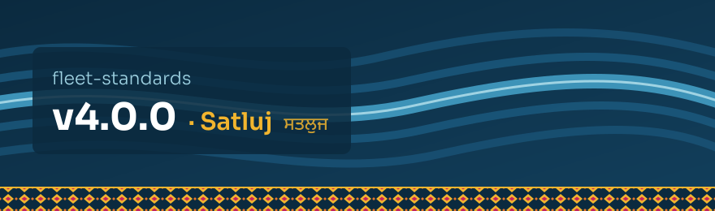

<p align="center">
  
</p>

<p align="center">
  
  
  <a href="LICENSE"></a>
  <a href="https://tinkertogether.studio"></a>
</p>

A shared rulebook, project templates, and agent skills for building projects with an AI coding
agent: Next.js apps, Node and Python tools, games in an engine, and repositories without
application code. It is written for Claude Code and works with **OpenAI Codex, GitHub
Copilot, Cursor and Gemini CLI** too.

<sub>Releases are named for the five rivers of Punjab: **v4 Satluj** · v5 Beas · v6 Ravi · v7
Chenab · v8 Jhelum</sub>

It answers the questions an agent otherwise guesses at: how code is structured, when to ask
instead of assuming, how visual changes get approved, when git is allowed, and how a
session hands over to the next one. Adopting it means your agent follows the same rules in
every project, and every project improves the same rulebook.

It is opinionated — built by [Tanveer](https://github.com/Tanveerfb) for his own projects
(Next.js, TypeScript, Tailwind, shadcn, Firebase; Python, Godot) and shared with whoever finds
it useful.
Wherever it says **"the owner"**, that means whoever owns the project: you, in yours.

---

## What you get

**The standard** — a **core**, [`standards/project-rules.md`](standards/project-rules.md),
that every repository loads, and **files a project loads by its kind**, in
[`standards/rules/`](standards/rules). Each is copied into the project and imported from its
`CLAUDE.md`, so a project loads only the rules that apply to it. Sections are referenced by
name (`§GIT`, `§MOTION`) wherever they live.

| File | Covers | Loaded by |
| --- | --- | --- |
| `project-rules.md` (the core) | Precedence and kinds, project documents with current truth kept apart from history, asking via the question tool, git and branching, the owner's approval loop and Process X, spec files, other agents, scaling `CLAUDE.md`, security and secrets, testing | every repository |
| `rules/app.md` | Building for growth, modules, naming, data adapters, entity lifecycles, shortcuts, packages, build discipline — in any language | anything with application code |
| `rules/ui.md` | Design motifs, components, quality of life, interface patterns, motion | anything with a visual surface |
| `rules/node.md` | TypeScript, state and validation, pnpm, Node version and environment checks | web projects and Node tools |
| `rules/web.md` | Next.js structure, forms, hooks, Tailwind tokens, shadcn | web projects |
| `rules/python.md` | uv, pyright, ruff, pytest; a package or a folder of scripts | Python tools |
| `rules/game.md` | What a game in an engine reads differently | games |
| `rules/non-application.md` | What a repository without application code does differently | those repositories |
| `rules/options/` | Firebase, SQLite, Trello (imported when chosen); AI and the studio credit (read when needed); a family of local sessions (only when asked for) | projects that chose them |

A web project loads the core, app, ui, node and web, about 67 KB; a Python tool loads the
core, app and python, about 44 KB. A `Rules:` line in `CLAUDE.md` declares the set
(`Rules: app, ui, node, web · Options: firebase, no-trello`).

**Nine skills** — instructions your agent loads when a phrase triggers them:

| Skill | Say | What happens |
| --- | --- | --- |
| `checkpoint` | "checkpoint", **"git checkpoint"**, "git checkpoint max" | Ends a session: updates `docs/STATUS.md` and the session log in `docs/log.md`, mirrors the status to Trello if the project has a board, then git. **"git checkpoint" means commit and push; anything else means no git** — except on a multi-branch project, where the working branch commits on its own and production changes only on "git CPR". |
| `relay` | "relay", "let's continue", "where were we" | Starts a session: reads the last handoff and checks it still matches the repo before any work. Runs on its own after a compact or a resume |
| `new-project` | "new project" | Sets up a new project of any kind on the standard — scaffold, rules for its kind, options, templates, agent wiring, and on your yes the GitHub repository and branch protection — then sets the design first where there is an interface and walks the checklist. Never commits. |
| `design-motif` | "set the design", "redesign" | Chooses (or records) the project's motif: show me, browse, decide for me, surprise me, or bring your own; mockups until you lock it; then records it |
| `ai-setup` | "set up AI", "add an AI feature" | Adds AI to a new or existing project: checks what's there, lets you choose Firebase AI Logic, the Vercel AI SDK or both, scaffolds the adapter, protects every model call, optionally wires local models (Ollama, LM Studio), and builds the first feature |
| `sync-standards` | "sync standards", "upgrade standards" | Brings a project up to the latest standard: one upgrade report of everything that would change, applied on your yes, then checked again |
| `propose-standard` | "propose a standard change" | Sends a fix or request back to this repo as a GitHub issue (a pull request if you ask) |
| `machine-inventory` | "machine inventory", "I just installed ffmpeg" | Records what this machine has installed in `~/.claude/machine.md`, so projects prefer it before proposing a tool |
| `session-family` | "set up a session family", "cross-session family" | Only when you ask: sets up several local sessions to work together, with one manager, a register, and rules for who may message, decide and edit what. Never offered |

**Design motifs** — [`standards/motifs.md`](standards/motifs.md): 35 families of themes
a project's interface can be designed around, in seven groups — Stationery, Classroom,
Claymorphism, Cyberpunk, Neo-brutalism, Maximalism, Shonen ink, Retro pixel, Heritage, Japandi
and more — each with named variants, plus universe-inspired motifs drawn from a fictional
world, and custom ones. See them before choosing: the
[gallery](standards/motif-gallery.html) has a sample tile for every family, and "show me"
drafts tiles of three or four candidates in your project's own words. Or browse, have the
agent recommend one from your site's purpose and audience, or let it surprise you. The
`design-motif` skill runs the whole process.

**Templates** — [`standards/templates/`](standards/templates): `CLAUDE.md`, `AGENTS.md`,
`conventions.md`, `decisions.md`, `docs/STATUS.md` and `docs/log.md` skeletons for a new
project; `pre-commit`, a tested hook that refuses commits containing anything shaped like a
credential; and a `.gitattributes` that keeps shell scripts on LF.

**Process X** — [`standards/process-x.md`](standards/process-x.md): a repeatable
whole-product audit and upgrade for a project that has outgrown its adoption.

---

## Install

### Claude Code — as a plugin

In any Claude Code session:

```
/plugin marketplace add Tanveerfb/fleet-standards
/plugin install fleet@tanveerfb
```

The skills appear as `fleet:checkpoint`, `fleet:relay`, `fleet:new-project`,
`fleet:design-motif`, `fleet:ai-setup`, `fleet:sync-standards`, `fleet:propose-standard`,
`fleet:machine-inventory` and `fleet:session-family`.
To receive updates automatically, open `/plugin` → **Marketplaces** → `tanveerfb` →
**Enable auto-update** (it is off by default). Otherwise run
`/plugin marketplace update tanveerfb` now and then.

**Optional — a studio credit and showcase.** If you run a studio and want to sign the
projects you build, add one line to your own `~/.claude/CLAUDE.md`:

```
Studio credit: <studio name> — "<credit wording, e.g. Built by …>" — <site URL> — <brand kit URL or path> — showcase <owner/repo> <file projects are listed in>
```

The `showcase` part is optional: include it if your studio's site lists its work. Every
project is then asked, once, whether it carries the credit and — with a showcase — whether
it is featured; featured projects request their entry and its updates as issues on the
studio site's repository (`§CREDIT`).

**Optional — a machine inventory.** A project does not know what your machine has unless you
say so each time. Say **"machine inventory"** and the skill probes the machine, read-only,
and writes `~/.claude/machine.md`, imported from your `~/.claude/CLAUDE.md` with one line:

```
@machine.md
```

The file holds the tools installed that matter to project work, with version and what each
is good for (ffmpeg, yt-dlp, Blender, ComfyUI, Ollama and the like), the hardware that
matters (GPU and its memory), and a short list of tools not installed but worth suggesting.
Never a credential. Agents read it before proposing a tool (`§AGENTS`); run the skill again
when you install something. One file per machine; cloud sessions have none and assume
nothing.

### Codex, Copilot, Cursor, Gemini CLI — with the installer

Needs `git` and Node 18 or later:

```
git clone https://github.com/Tanveerfb/fleet-standards.git
node fleet-standards/standards/scripts/install-skills.mjs
```

| Installs | To | Read by |
| --- | --- | --- |
| The nine skills | `~/.agents/skills/` | Gemini CLI, GitHub Copilot, Cursor |
| The nine skills | `~/.codex/skills/` | OpenAI Codex |
| The rules set, templates and scripts | `~/.agents/fleet/` | The skills, which look for the standard there |

Restart your agent afterwards. To update: `git pull` in the clone and run the installer again
— or just say "sync standards" in a project, which does both.

---

## Use it in a project

### New project

Install the plugin (above), open a session in an empty folder, and say **"new project"**. If
you have a written spec, point the session at it — the skill takes the project's purpose and
audience from it. It scaffolds the app, puts the rules and templates in place, wires the
plugin and the other-agent pointers, then runs **design-motif** so the design is decided
before anything visual is built, and finishes by walking the checklist with you. Nothing is
committed until you say `git checkpoint`.

To do the same by hand, for a web project (other kinds load other files: the table above):

1. `pnpm dlx create-next-app@latest --use-pnpm` — TypeScript, Tailwind, App Router, `src/`,
   `@/` alias.
2. Make sure `.gitignore` covers `.env*` (except `.env.example`) and `.secrets/` **in the first
   commit**, before any code. Pin Node to your deploy platform's version in `package.json`
   `engines` and `.nvmrc`.
3. Copy [`standards/project-rules.md`](standards/project-rules.md) to the project root, and
   the files its kind loads from [`standards/rules/`](standards/rules) into a `rules/`
   folder beside it (for a web project: `app.md`, `ui.md`, `node.md`, `web.md`, and any
   option you chose from `rules/options/`).
4. Copy the templates and fill in what you know, leaving the rest as `TODO`:
   - `CLAUDE.template.md` → `CLAUDE.md` — the one file holding project-specific instructions,
     with the `Rules:` line and one `@rules/<name>.md` import per file
   - `AGENTS.template.md` → `AGENTS.md` **and** `GEMINI.md` — pointers that send Codex,
     Copilot, Cursor and Gemini CLI to `CLAUDE.md`
   - `conventions.template.md` → `conventions.md`, `decisions.template.md` → `decisions.md`
   - `STATUS.template.md` → `docs/STATUS.md` (`log.template.md` → `docs/log.md` arrives with
     the first checkpoint)
5. Say **"sync standards"** once. It wires the project to the plugin (so every Claude Code
   session there loads the skills) and checks the pointers are in place.
6. Say **"set the design"** to choose the motif before any interface work.
7. Work through the checklist at the end of the `new-project` skill
   ([`standards/skills/new-project/SKILL.md`](standards/skills/new-project/SKILL.md)).

Only create the other documents the standard mentions once they have something in them —
`§DOCS` explains why.

### Existing project

Don't copy the rules in and start "fixing" code. Read
[`standards/adopting-the-standard.md`](standards/adopting-the-standard.md) first. The first
pass writes a `conventions.md` recording every gap — as an exception you approve, or as
known backlog — and **changes no code**. Along the way, `design-motif` records the look the
site already has as its motif, without redesigning anything. The guide ends with a ready-made
kickoff prompt for your agent.

### Day to day

- Start a session with **"relay"**, end it with **"checkpoint"** or **"git checkpoint"**.
- A checkpoint ends by asking whether to compact. A plain `/compact` is enough: the state a
  conversation would lose is in the status doc's **Live** line, and a hook has the next
  session run relay first, before anything you asked for.
- Your agent offers choices through its question tool, and asks open questions in plain text
  you can answer in your own words — typed or by voice (`§ASK`).
- Every visual change starts as a mockup you approve, and fits the project's motif
  (`§OWNER`, `§DESIGN`).
- **"Redesign"** when the look needs an overhaul — `design-motif` runs the motif process again.
- Now and then, **"sync standards"** to pick up rule changes. The sync reads the project
  first and shows one upgrade report: the files its kind loads (one question to confirm the
  kind), the `Rules:` line and imports it will write, each option asked once (a no is
  recorded, so it is never asked again), and every other change, each with the check that
  found it. Nothing changes until you say yes; afterwards it runs the checks again and says
  what is still left. A project coming from v3's single file takes the same path. You rarely
  need to remember:
  the plugin's update check has the agent ask you. It runs when a session starts, and at
  most once a day per project when one is resumed or compacted. It compares the project's
  rules with the plugin's copy, and **once a day asks GitHub what the released version is**
  (one small public file is fetched; nothing about your project is sent; offline, it stays
  silent). So a release reaches you even when the plugin has not updated itself: the agent
  then asks whether to update the plugin and sync. Say no, and it stays quiet until a newer
  version ships. Set `FLEET_MASTER_URL=off` to stop it asking GitHub. `relay` makes the
  same check, which covers cloud sessions (they do not install plugins) and other agents.
- Agents change files with their editor tools, never the shell, so you see a reviewable diff.
  The plugin enforces it: a hook refuses inline Python or Node scripts and heredocs that
  write files (`§AGENTS`); `sync-standards` adds the same hook to each project for cloud
  sessions.

---

## Changing the standard

Never edit `project-rules.md`, a file in `rules/` or a copied skill inside a project — the
next sync overwrites it, and nobody else gets the fix. Instead, in the project where you hit the problem, say **"propose a standard
change"**. The skill drafts the change with evidence from that project and opens an issue on
this repo, in the same shape as the repo's *Propose a standard change* issue template. The maintainer decides; once merged, every project picks it up with
`sync-standards`.

You can also open an issue or pull request here directly. A change to any rules file bumps
the one version in the core's header and gets an entry in
[`standards/CHANGELOG.md`](standards/CHANGELOG.md); [`docs/maintainer.md`](docs/maintainer.md)
has the release steps.

---

## Troubleshooting

- **Install or update fails on a private fork.** Claude Code fetches with your machine's git
  credentials and cannot prompt for them. Run `gh auth login`, then `gh auth setup-git`.
- **Every skill appears twice in Claude Code.** In a synced project that is expected: the
  project carries copies in `.claude/skills/` for cloud sessions, which install no plugins,
  so you see `/checkpoint` and `/fleet:checkpoint`. They behave the same. Anywhere else, you
  have old copies in `~/.claude/skills/` from before the plugin; delete those folders.
- **Skills don't show up in Copilot's or Cursor's cloud agents.** Skills installed to your
  home folder load only on your machine. Cloud agents don't see them.
- **The agent ignores the rules (Codex, Copilot, Cursor, Gemini CLI).** Check the project has
  `AGENTS.md` and `GEMINI.md` from the template. `CLAUDE.md` loads the rules with an `@` line
  that only Claude Code understands; the pointer tells other agents to read them directly.

---

## Repository layout

```
.claude-plugin/marketplace.json   makes this repo a Claude Code plugin marketplace
standards/                        the standard — also the `fleet` plugin
  project-rules.md                the core every repository loads
  rules/                          the files each kind loads: app, ui, node, web, python,
                                  game, non-application
  rules/options/                  firebase, sqlite, trello, ai, credit
  motifs.md                       the design motif catalogue
  motif-gallery.html              a sample tile for every motif family
  CHANGELOG.md                    version history, where each section lives, the v2 → v3 map
  adopting-the-standard.md        bringing an existing project onto the standard
  templates/                      starting files for a project
  skills/                         checkpoint, relay, new-project, design-motif, ai-setup,
                                  sync-standards, propose-standard, machine-inventory,
                                  session-family
  process-x.md                    Process X: the whole-product audit, step by step
  hooks/hooks.json                update check: offers sync-standards when rules fall behind;
                                  relay after a compact or a resume; shell-write guard:
                                  refuses inline scripts and file-writing heredocs (§AGENTS)
  scripts/check-rules-version.mjs the script behind the update check
  scripts/after-compact.mjs       the script behind relay-after-compact
  scripts/block-shell-writes.mjs  the script behind the shell-write guard
  scripts/copy-skills-to-project.mjs  copies the skills into a project for cloud sessions
  scripts/install-skills.mjs      installer for non-Claude agents
  scripts/sync-rules.mjs          reports the rules version across a folder of projects
  scripts/rules-line.mjs, standard.mjs  read a project's Rules line; list the standard's files
  evals/                          behaviour evals for the skills (run by hand; they cost usage)
docs/maintainer.md                notes for maintaining this repo
docs/claude-skills.md             the maintainer's other plugins, for reference
docs/assets/                      the README banner and the script that draws it
docs/STATUS.md, decisions.md      where the standard's own work is, and why it chose what it did
tests/run.mjs                     repository checks; CI runs them on every push
.github/workflows/checks.yml      the CI
LICENSE                           MIT
```

Templates are named `.template.md` on purpose: a file called `CLAUDE.md` in this repo would
be loaded as instructions by anyone opening the repo in Claude Code.

---

## Versions

Current: **v4.1.0** (2026-11-27), **Satluj**. See [`standards/CHANGELOG.md`](standards/CHANGELOG.md)
for what changed and why: where each section lives now, what a project must change to move
up, and the map from v2 section numbers to v3 names.

---

## Who maintains it

Built and maintained by **[Tinker Together](https://tinkertogether.studio)**, a small web and AI
studio in Sydney. It is the studio's own way of working — every project it builds runs on this
standard — published so anyone can use it. Proposals from other projects are welcome
(`propose-standard`).

## License

[MIT](LICENSE) — use it, copy it, adapt it to your own projects. Keep the copyright notice.
